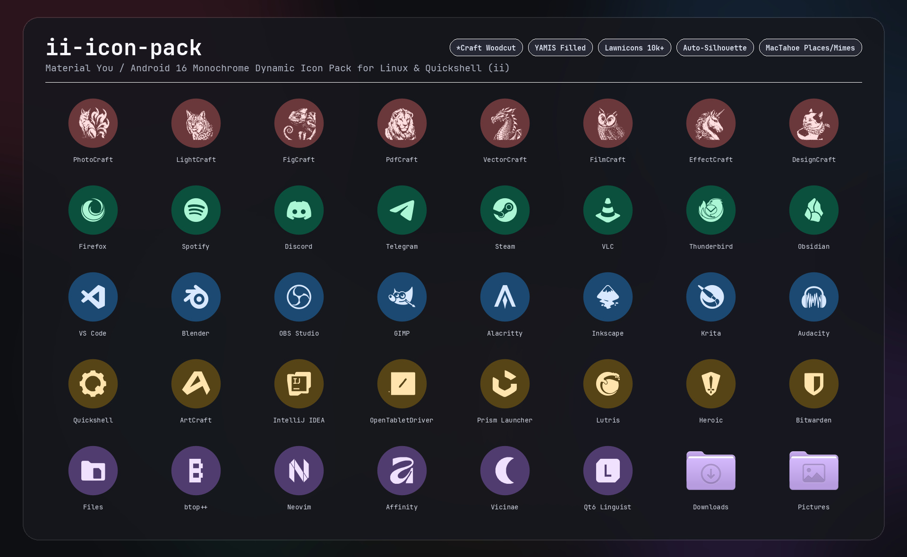

# ii-icon-pack



A Material You / Android 16 monochrome circular icon pack for Linux desktops, designed for dynamic wallpaper-based recoloring in Quickshell (`ii`) and standalone dark/tinted setups.

## Icon Priority Architecture

`ii-icon-pack` combines multiple open-source icon sets using a strict priority pipeline (`scripts/build_theme.py`):

1. **Priority 1 — Craft App Suite (Woodcut Bicolor):** All 14 Storyteller `*Craft` applications (`ArtCraft Launcher`, `PhotoCraft`, `LightCraft`, `FigCraft`, `PdfCraft`, `VectorCraft`, `FilmCraft`, `EffectCraft`, `DesignCraft`, `WordCraft`, `DeckCraft`, `GridCraft`, `CADCraft`, `SoundCraft`) rendered in bicolor woodcut engraving style.
2. **Priority 2 — YAMIS (Filled Silhouettes):** Desktop Linux applications and system preferences from *Yet Another Monochrome Icon Set*, using filled monochrome glyphs inside a uniform circular container.
3. **Priority 3 — Lawnicons (Android 16):** Over 10,000 vector icons from Lawnicons to cover remaining applications, web apps, and games.
4. **Priority 4 — Linux Freedesktop & `.desktop` Aliases:** Over 21,000 symlink aliases covering Flatpak, Snap, AppImage, Steam, JetBrains IDEs, Qt tools, Waydroid, and standard `.desktop` `Icon=` / `Name=` / `StartupWMClass=` metadata.
5. **Priority 5 — Auto-Silhouette Extractor (`sources/auto`):** Automatically strips non-circular background plates (squares, squircles, cut-corner Qt tiles like `org.quickshell`, two-tone diagonal plates like `linguist-qt6`, `otd`, `awcc`, etc.) from any remaining unmapped system icons and vectorizes their foreground logo into a clean monochrome circular `ii-icon-pack` icon.
6. **Non-Application Icons — MacTahoe (`places`, `mimes`, `actions`, `devices`, `status`):** Folders, file types, devices, and UI symbolic icons use the high-resolution `MacTahoe-dark` design (with folders dynamically tinted by Material You and file types preserving their rich native document colors).

---

## Installation Guide

### 1. Clone and Install the Icon Pack

Clone this repository and copy (or symlink) the `ii-icon-pack` theme directory into your local icons folder:

```bash
git clone https://github.com/P3DROVFX/ii-icon-pack.git ~/Downloads/ii-icon-pack
mkdir -p ~/.local/share/icons
ln -sfn ~/Downloads/ii-icon-pack/ii-icon-pack ~/.local/share/icons/ii-icon-pack
```

*(Alternatively, copy the folder with `cp -r ~/Downloads/ii-icon-pack/ii-icon-pack ~/.local/share/icons/ii-icon-pack`.)*

---

### 2. For Quickshell (`ii`) Users (Dynamic Material You Recoloring)

`ii-icon-pack` is pre-calibrated for native compatibility with the `recolor_icons.py` engine in `ii` (its circular container tone maps automatically to `primary_container` and its foreground silhouette maps to `primary` / `on_primary_container`):

1. Open **Settings → Appearance → Icons** in your Quickshell (`ii`) panel.
2. Enable **Themed Icons** (Dynamic Recoloring).
3. Select **ii-icon-pack** as your **Icon Theme**.
4. Or apply it directly from the terminal:
   ```bash
   python3 ~/.config/quickshell/ii/scripts/colors/recolor_icons.py --force --base ii-icon-pack
   ```

Whenever you change your wallpaper or Material You color scheme, `ii` will automatically recolor the entire `ii-icon-pack` pack to match your active palette.

---

### 3. For Standard Linux Users (Without Quickshell `ii`)

If you do not use Quickshell `ii`, you can activate `ii-icon-pack` directly in your desktop environment or window manager:

#### GNOME / GTK Desktops (Hyprland, Sway, Niri, XFCE)
```bash
gsettings set org.gnome.desktop.interface icon-theme 'ii-icon-pack'
```

For GTK 3 and GTK 4 configuration files (`~/.config/gtk-3.0/settings.ini` and `~/.config/gtk-4.0/settings.ini`):
```ini
[Settings]
gtk-icon-theme-name=ii-icon-pack
```

#### KDE Plasma / Qt Applications (`kdeglobals` / `qt6ct`)
1. Open **System Settings → Colors & Themes → Icons** and select **ii-icon-pack**, or run:
   ```bash
   kwriteconfig6 --file kdeglobals --group Icons --key Theme ii-icon-pack
   ```
2. If you use `qt5ct` or `qt6ct` on a standalone window manager, open `qt6ct` → **Icon Theme** → select **ii-icon-pack**.

---

## Rebuilding the Icon Pack from Source

To rebuild the `ii-icon-pack` directory after adding new SVGs or updating upstream sources:

```bash
python3 scripts/build_theme.py
```

## License

Released under the [GNU General Public License v3.0](LICENSE).

