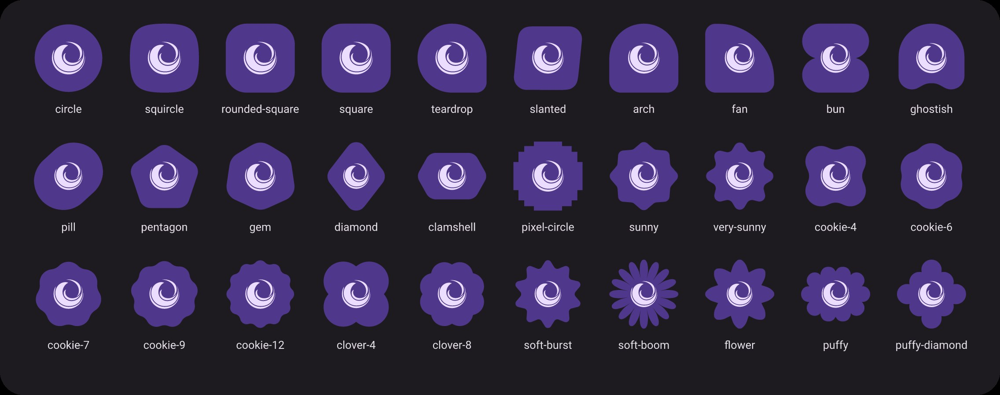

# ii-icon-pack


A Material You / Android 16 monochrome icon pack (circle, squircle or any Material 3 Expressive shape) for Linux desktops, designed for dynamic wallpaper-based recoloring in Quickshell (`ii`) and standalone dark/tinted setups.

## Icon Priority Architecture

`ii-icon-pack` combines multiple open-source icon sets using a strict priority pipeline (`scripts/build_theme.py`):

1. **Priority 1 — Craft App Suite (Woodcut Bicolor):** All 14 Storyteller `*Craft` applications (`ArtCraft Launcher`, `PhotoCraft`, `LightCraft`, `FigCraft`, `PdfCraft`, `VectorCraft`, `FilmCraft`, `EffectCraft`, `DesignCraft`, `WordCraft`, `DeckCraft`, `GridCraft`, `CADCraft`, `SoundCraft`) rendered in bicolor woodcut engraving style.
2. **Priority 2 — YAMIS (Filled Silhouettes):** Desktop Linux applications and system preferences from *Yet Another Monochrome Icon Set*, using filled monochrome glyphs inside a uniform circular container.
3. **Priority 3 — Lawnicons (Android 16):** Over 10,000 vector icons from Lawnicons to cover remaining applications, web apps, and games.
4. **Priority 4 — Linux Freedesktop & `.desktop` Aliases:** Over 21,000 symlink aliases covering Flatpak, Snap, AppImage, Steam, JetBrains IDEs, Qt tools, Waydroid, and standard `.desktop` `Icon=` / `Name=` / `StartupWMClass=` metadata.
5. **Priority 5 — Auto-Silhouette Extractor (`sources/auto`):** Automatically strips non-circular background plates (squares, squircles, cut-corner Qt tiles like `org.quickshell`, two-tone diagonal plates like `linguist-qt6`, `otd`, `awcc`, etc.) from any remaining unmapped system icons and vectorizes their foreground logo into a clean monochrome circular `ii-icon-pack` icon.
6. **Non-Application Icons — MacTahoe (`places`, `mimes`, `actions`, `devices`, `status`):** Folders, file types, devices, and UI symbolic icons use the high-resolution `MacTahoe-dark` design (with folders dynamically tinted by Material You and file types preserving their rich native document colors).

---

## Icon Shapes

Every app icon can be drawn on any of 30 plates: the Android launcher masks (circle, squircle, rounded square, teardrop) and the Material 3 Expressive shapes, exported from the same shape library Quickshell `ii` draws its UI with, so a `cookie-9` icon matches a `Cookie9Sided` shape in the shell exactly.



Logos are automatically shrunk on deeply scalloped shapes (cookies, clovers, bursts) so they never touch an edge, and full-bleed artwork (the *Craft woodcuts) is clipped to the new plate.

---

## Installation Guide

### 1. Install the Icon Pack

One command, no extra dependencies besides Python 3:

```bash
curl -fsSL https://raw.githubusercontent.com/P3DROVFX/ii-icon-pack/main/install.sh | bash -s -- --shape squircle --set-theme
```

This keeps a checkout in `~/.local/share/ii-icon-pack` and renders the theme into `~/.local/share/icons/ii-icon-pack`. Running it again updates the pack and keeps the shape you picked. From a clone, the same is `./install.sh --shape squircle`.

| Flag | What it does |
| --- | --- |
| `--shape NAME` | Plate shape: `circle` (default), `squircle`, `rounded-square`, `square`, `teardrop`, `cookie-4` … `cookie-12`, `clover-4`, `clover-8`, `sunny`, `flower`, `puffy`, … (`python3 scripts/iipack.py shapes` lists them all) |
| `--plate-scale F` | Icon size inside its canvas, `0.6`–`1.08` (default `1`) |
| `--glyph-scale F` | Logo size on the plate, `0.5`–`1.5` (default `1`, on top of the shape's own factor) |
| `--plate-color #rrggbb` / `--glyph-color #rrggbb` | Static colors, for desktops that do not recolor icons |
| `--set-theme` | Also select the pack in GTK (gsettings + `settings.ini`) and KDE (`kdeglobals`) |

Everything else lives in `scripts/iipack.py`:

```bash
python3 scripts/iipack.py install --shape cookie-9   # reshape (takes a few seconds)
python3 scripts/iipack.py status --remote            # installed version, shape, update available?
python3 scripts/iipack.py update                     # pull the newest pack and reinstall with the same options
python3 scripts/iipack.py uninstall
```

---

### 2. For Quickshell (`ii`) Users (Dynamic Material You Recoloring)

`ii-icon-pack` is pre-calibrated for native compatibility with the `recolor_icons.py` engine in `ii` (its circular container tone maps automatically to `primary_container` and its foreground silhouette maps to `primary` / `on_primary_container`):

Everything can be done from inside the shell: open **Settings → Interface & Fonts → Themed Icons**. The **ii-icon-pack** section installs the pack from GitHub with one button, shows whether an update is available, and lets you pick the icon shape (with live previews in your current palette) and the icon/logo sizes. Changes are rendered and recolored automatically.

The same actions are exposed over IPC, for keybinds and scripts:

```bash
qs -c ii ipc call iconPack setShape squircle
qs -c ii ipc call iconPack setScales 1.0 0.9
qs -c ii ipc call iconPack update
```

Manually:

1. Enable **Themed Icons** (Dynamic Recoloring).
2. Select **ii-icon-pack** as your **Icon Theme**.
3. Or apply it directly from the terminal:
   ```bash
   python3 ~/.config/quickshell/ii/scripts/colors/recolor_icons.py --force --base ii-icon-pack
   ```

Whenever you change your wallpaper or Material You color scheme, `ii` will automatically recolor the entire `ii-icon-pack` pack to match your active palette.

---

### 3. For Standard Linux Users (Without Quickshell `ii`)

If you do not use Quickshell `ii`, you can activate `ii-icon-pack` directly in your desktop environment or window manager:

#### GNOME / GTK Desktops (Hyprland, Sway, Niri, XFCE)
```bash
gsettings set org.gnome.desktop.interface icon-theme 'ii-icon-pack'
```

For GTK 3 and GTK 4 configuration files (`~/.config/gtk-3.0/settings.ini` and `~/.config/gtk-4.0/settings.ini`):
```ini
[Settings]
gtk-icon-theme-name=ii-icon-pack
```

#### KDE Plasma / Qt Applications (`kdeglobals` / `qt6ct`)
1. Open **System Settings → Colors & Themes → Icons** and select **ii-icon-pack**, or run:
   ```bash
   kwriteconfig6 --file kdeglobals --group Icons --key Theme ii-icon-pack
   ```
2. If you use `qt5ct` or `qt6ct` on a standalone window manager, open `qt6ct` → **Icon Theme** → select **ii-icon-pack**.

---

## Rebuilding the Icon Pack from Source

To rebuild the `ii-icon-pack` directory after adding new SVGs or updating upstream sources:

```bash
python3 scripts/build_theme.py                    # circular plates (what the repository ships)
python3 scripts/build_theme.py --shape squircle   # build straight into another shape
```

The repository always ships circular plates; installs reshape a copy, so the checkout stays clean. To refresh the Material shapes after the shell's shape library changes:

```bash
node scripts/tools/export_material_shapes.js ~/.config/quickshell/ii/modules/common/widgets/shapes > scripts/material_shapes.json
```

## License

Released under the [GNU General Public License v3.0](LICENSE).

